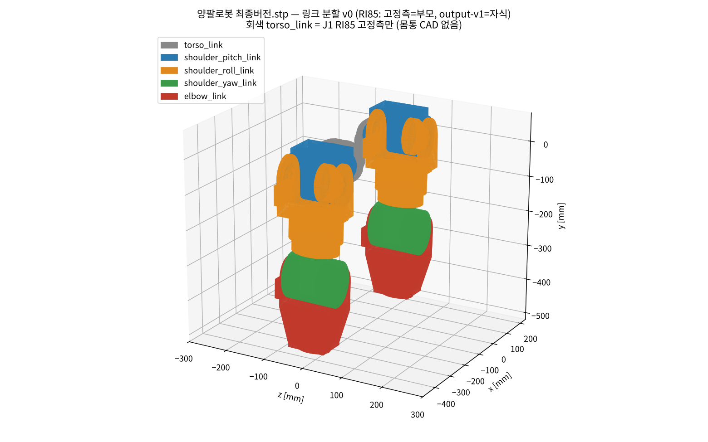

# 우리 로봇 링크 분할표 v0 — STEP ↔ ICD 링크 이름 ↔ BOM

| 항목 | 내용 |
|---|---|
| 상태 | **v0** (week04, 박종진, 2026-10-13) — 함태훈(메시 · 관성) 검토 전 |
| 입력 | `양팔로봇 최종버전.stp` (Inventor 2026, AP214, mm, 2026-09-18) · `BASE 3.STEP` (SolidWorks 2025, 상판만) — **원본은 저장소에 올리지 않음** (.gitignore) |
| 방법 | OCCT(cadquery-ocp)로 어셈블리 트리 · 부품 체적 · COM을 뽑고, **부품 사이 거리 0 mm 접촉**으로 어떤 부품이 어떤 구동기 쪽에 붙는지 판정. RI85는 고정측(housing · RI85-PH · encoder cover)과 출력측(output-v1)을 나눠서 접촉 확인 |
| 스크립트 | [step_tree.py](../../members/park-jongjin/week04/scripts/step_tree.py) · [step_joint_axes.py](../../members/park-jongjin/week04/scripts/step_joint_axes.py) · [step_contacts.py](../../members/park-jongjin/week04/scripts/step_contacts.py) · [step_link_split.py](../../members/park-jongjin/week04/scripts/step_link_split.py) · [step_link_split_plot.py](../../members/park-jongjin/week04/scripts/step_link_split_plot.py) |
| 결과 | 부품별 표 [link_split_parts.csv](../../members/park-jongjin/week04/results/link_split_parts.csv) (46행) · 접촉 [contacts.txt](../../members/park-jongjin/week04/results/contacts.txt) · 축 [joint_axes.txt](../../members/park-jongjin/week04/results/joint_axes.txt) · 그림 [20261013_link_split.png](../../members/park-jongjin/week04/img/20261013_link_split.png) |
| BOM | **미수령** — BOM 열은 STEP 부품명을 키로 비워 둠 (수령 시 질량 · 재질 · 구동기 모델 기입) |

## 0. 먼저 알아야 할 것 (CAD에서 확인한 사실)

| No. | 사실 | 근거 | 영향 |
|---|---|---|---|
| F1 | **팔 1개당 RI85 구동기 4개 → 팔 4-DOF** (어깨 3 + 팔꿈치 1). 손목 구동기 없음, 끝은 `그리퍼 플랜지`뿐 | 최상위 인스턴스 38개 중 RI85 8개, 팔당 4개 (step_tree_arm.txt) | 기획서 목표 「팔 6-DOF × 2」와 **2-DOF 차이** → 손목 2축을 보완설계(A1 · A2)에서 추가하는지 확인 필요. 골격 URDF는 **CAD대로 4-DOF**로 만들고 손목은 확정 후 추가 |
| F2 | 몸통(torso) 없음 — J1 RI85 고정측 뒷면(x = −43 / −306 mm)이 어떤 부품과도 닿지 않음 | contacts.txt (RI85:1 · :6 HOUS 접촉 0건) | torso_link는 임시 box, 어깨 장착 위치만 맞춤 (커리큘럼 지시) |
| F3 | 팔이 **−y 방향으로 뻗고**, 두 팔은 **x 방향**으로 떨어져 있음 → CAD y = 위, x = 좌우. z(앞/뒤) 부호는 CAD만으로 판단 불가 | 바운딩 박스 690 × 560 × 163 mm, 팔 끝 y = −495 | **좌/우 이름은 가정**(아래 1절) — 팀장 확인 |
| F4 | 체적 합 **10.22 L** (팀장 미리보기 10.1 L와 일치), 링크 분할 46행 합과 동일 | link_split_summary.txt | 분할에서 빠진 부품 없음 |
| F5 | 리치: J1 축(y = 0) → 플랜지 면(y = −495) **495 mm** | step_tree_arm.txt | 기획서 「상체 리치 700 mm급」보다 짧음 (손목 · 그리퍼 미포함) |

## 1. 좌표 · 좌/우 (가정 — 팀장 확인 필요)

- CAD → ICD 로봇 좌표(x 전방 · y 좌측 · z 상방, REP-103): **+z_CAD = 전방 가정** → `x_robot = z_CAD`, `y_robot = x_CAD`, `z_robot = y_CAD`
- 그러면 **CAD x+ 쪽 팔 = left**, x− 쪽 팔(「(반대)」 브래킷이 있는 쪽) = **right**. 전방이 −z면 좌우가 바뀜
- 몸통 중심선 x_CAD = **−118.2 mm** (양쪽 J1 출력면 51.6 / −287.9의 중점)

## 2. 링크 분할표 (팔 1개 기준, left = CAD x+ 쪽. right는 「(반대)」 · 인스턴스 번호만 다름)

규칙: 링크 = 서로 상대 운동이 없는 부품 묶음. **RI85 1개는 강체 2개로 나눔** — 고정측(housing · 유성기어 · 베어링 · 엔코더 · PCB = 부모 링크), **출력과 같이 도는 부품 = `output-v1` + `ring2`(출력 링기어) + `cover plate1`** 만 자식 링크 (셋이 0 mm로 맞닿음 — 함태훈 지적 10/13, OCCT로 재확인: output-v1 접촉 = ring2 · cover plate1 · 크로스롤러 베어링). ring1은 하우징에 고정. 내부 기어 · 로터의 회전 관성은 메시가 아니라 **armature(J_rotor · N²)** 로 넣음 (체크리스트 E6).

| ICD 링크 이름 | STEP 부품 (left / right 인스턴스) | 체적 cm³ (L / R) | Al 가정 질량 kg* | COM (CAD mm, left) | BOM |
|---|---|---|---|---|---|
| `torso_link` | (CAD 없음) + **RI85 J1 고정측** (RI85:1 / RI85:6) | 563 / 563 | 1.52 (+ 몸통 미정) | (11, 0, 0) | |
| `left_shoulder_pitch_link` | 어깨 브래킷1 · 어깨 브래킷2 (/(반대)), RI85 J1 출력부, **RI85 J2 고정측** (RI85:2 / :5), 보조 베어링 6810 (:1 / :3), 모터드라이버 예상 (:1 / :2) | 1,397 / 1,420 | 3.77 | (134, −11, 0) | |
| `left_shoulder_roll_link` | C브래킷1(수정본) · C브래킷2(수정본), 상완원통 일체형, RI85 J2 출력부, **RI85 J3 고정측** (RI85:3 / :7), 모터드라이버 예상 (:3 / :4) | 1,325 / 1,325 | 3.58 | (160, −113, −1) | |
| `left_shoulder_yaw_link` | 상완 칼라1 · 상완 칼라2, RI85 J3 출력부, **RI85 J4 고정측** (RI85:4 / :8), 보조 베어링 6810 (:2 / :4) | 1,005 / 1,005 | 2.71 | (160, −281, −6) | |
| `left_elbow_link` | 전완요크1 · 전완요크2, 그리퍼 플랜지, RI85 J4 출력부, 모터드라이버 예상 (:5 / :6) | 811 / 811 | 2.19 | (160, −378, −6) | |
| `left_tool0` (fixed, 질량 0) | 그리퍼 플랜지 바깥면 중심 (159, −495, −9) | – | – | – | |

\* **Al 가정 질량 = 체적 × 2.70 g/cm³ — 질량으로 쓰면 안 됨.** RI85는 강재 기어 · 베어링 · 모터가 섞여 있어 실제보다 가볍게 나옴. 링크 질량 · 관성은 함태훈 표(FreeCAD 재질 지정 · BOM 대조)로 교체.

접촉 근거 (contacts.txt, left 팔): `RI85:1/OUT — 어깨 브래킷1`, `어깨 브래킷1 · 2 — RI85:2/HOUS`, `RI85:2/OUT — C브래킷1`, `C브래킷2 — RI85:3/HOUS · 상완원통`, `RI85:3/OUT — 상완 칼라1`, `상완 칼라1 — RI85:4/HOUS`, `RI85:4/OUT — 전완요크1`, `전완요크1 · 2 — 그리퍼 플랜지`. J2 · J4는 반대편에 **보조 베어링 6810**(50 × 65 × 7)이 있는 **양지지(요크)** 구조.

## 3. 관절 표 (CAD에서 뽑은 축 — 골격 URDF 입력)

축 = `output-v1` 디스크의 대칭축(관성 주축), 방향 = 고정측 → 출력측. 위치 = 출력 디스크 중심 (mm, CAD 좌표).

| ICD joint | 구동기 | 부모 → 자식 | left (CAD x+) 축 위치 · 방향 | right (CAD x−) | 로봇 좌표 축 (1절 가정) |
|---|---|---|---|---|---|
| `{side}_shoulder_pitch_joint` | RI85 | torso → shoulder_pitch | (51.6, 0, 0) · **+x** | (−287.9, 0, 0) · −x | 좌우축 (±y) → pitch |
| `{side}_shoulder_roll_joint` | RI85 | shoulder_pitch → shoulder_roll | (159.5, −20.0, 41.2) · **+z** | (−395.7, −20.0, 41.2) · +z | 전후축 (x) → roll |
| `{side}_shoulder_yaw_joint` | RI85 | shoulder_roll → shoulder_yaw | (159.5, −202.3, −2.2) · **−y** (z 성분 −0.024) | (−388.6, −201.8, −2.2) | 상하축 (−z) → yaw |
| `{side}_elbow_joint` | RI85 | shoulder_yaw → elbow | (159.6, −296.1, 38.3) · **+z** (y 성분 −0.024) | (−388.5, −295.6, 38.3) | 영점 자세에서 전후축 (x) |

- 링크 길이 (left): 어깨 오프셋 J1 → J2 = x 107.9 · y −20.0 mm, 상완 J2 → J4 = **276.1 mm**, 전완 J4 → 플랜지 = **198.9 mm**
- 영점 자세 = STEP 자세(팔 아래로 곧게, ICD 3.2와 같음). 이 자세에서 팔꿈치 축이 전후축이라 팔꿈치가 **옆으로** 굽음 → 앞으로 굽히려면 shoulder_yaw ±90°. 영점 정의를 이대로 둘지 팀장 확인

## 4. CAD 조립 이상 (A1에 전달할 것)

| No. | 내용 | 수치 | 시뮬레이션 처리 |
|---|---|---|---|
| D1 | J3 · J4 축이 x축 둘레로 **1.4° 기울어짐** (양팔 모두) — J2 축(z)은 기울지 않아 관절 회전으로는 설명 안 됨 | axis z 성분 −0.024 (0.024 rad = 1.4°) | 골격 URDF는 이상 축(정렬)으로, 차이는 기록 |
| D2 | right 팔 상완 이하(상완원통 · 칼라 · 요크 · 플랜지 · J3 · J4)가 left 팔의 거울 위치보다 x로 **7 mm** 어긋남 (J2는 거울 위치와 0.1 mm 일치) | 거울 위치 −395.8 vs 실제 −388.6 mm | 골격 URDF는 거울 대칭(ICD 3.4)으로 작성 |
| D3 | RI85 인스턴스 2 · 4 · 8에 `encoder cover`가 없음 (1 · 3 · 5 · 6 · 7에는 있음) | 22.6 cm³ 차이 (691.3 vs 668.8) | 관성 계산 시 누락 부품 보정 여부 결정 |
| D4 | 모터드라이버 예상 6개 = 팔당 3개 (J1 드라이버 위치 없음) | – | 몸통 설계 시 확인 |

## 5. 베이스 (BASE 3.STEP)

- 단일 솔리드 상판 **576 × 472 × 12 mm**, 체적 1,366.7 cm³ (Al 가정 3.69 kg). 휠 · 프레임 · 배터리 없음
- 하체 실측표(함태훈 week02)는 **보류 상태**라 치수 · 질량 없음 → 골격 URDF의 베이스는 상판 크기 box + 높이 · 질량 **가정값**(가정값 표에 기록)
- 상판 위 몸통 · 어깨 장착 위치(상판 대비 높이)는 CAD에 없음 → 가정값

## 6. 확인 요청 (팀장)

1. 팔 4-DOF(CAD) vs 목표 6-DOF — 손목 2축 추가 계획이 있는지, 4주차 v0는 4-DOF로 가도 되는지
2. CAD +z가 로봇 전방인지 (좌/우 이름 확정)
3. 영점 자세에서 팔꿈치가 옆으로 굽는 정의를 유지할지
4. D1 · D2 조립 이상을 A1에 전달할지

## 변경 이력

| 버전 | 날짜 | 내용 |
|---|---|---|
| v0 | 2026-10-13 | 최초 — RI85 자식 링크 = output-v1만 |
| v0.1 | 2026-10-13 | **함태훈 검증 반영**: 자식 링크 = output-v1 + ring2 + cover plate1 (elbow 질량 2.1425 → 2.2677 kg, 함태훈 2.268 kg와 일치). 골격 관절 검증(함태훈 [joint_check_skeleton.csv](https://github.com/taehoonham0118-cell/-1-/blob/main/sim/robot/joint_check_skeleton.csv)): 어깨 pitch · roll 앵커 ≤ 0.05 mm · 축 0.01°, yaw · elbow 1.37° · 7.4 mm는 §4 D1 · D2 이상화로 의도된 차이 |
